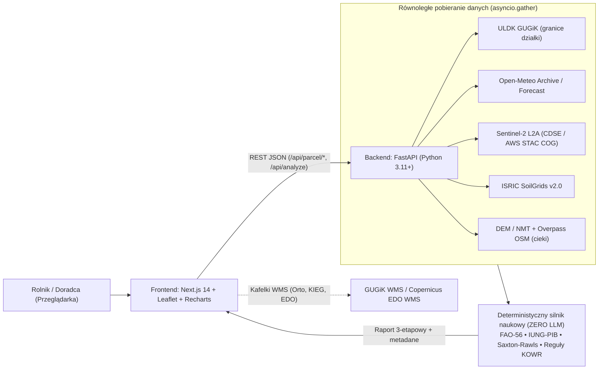

# Zatrzymaj wodę, chroń plony — System Wsparcia Gospodarowania Wodą w Rolnictwie (KOWR • HackNation 2026)

Publiczna e-usługa doradztwa wodnego i retencyjnego dla rolników opracowana w ramach zadania **Krajowego Ośrodka Wsparcia Rolnictwa (KOWR)** na hackathon **HackNation 2026**.

Aplikacja umożliwia wybranie konkretnej działki ewidencyjnej (kliknięciem na mapie lub po identyfikatorze **TERYT**), wskazanie uprawy i daty analizy (bieżącej lub historycznej z ostatnich 10 lat), a następnie w czasie kilku sekund generuje audytowalny, 3-etapowy raport doradczy gotowy do wydruku PDF A4.

---

## Spis treści

1. [Instrukcja uruchomienia](#1-instrukcja-uruchomienia)
2. [Opis problemu, funkcjonalności i korzyści dla rolnika](#2-opis-problemu-funkcjonalności-i-korzyści-dla-rolnika)
3. [Skrócony opis architektury](#3-skrócony-opis-architektury)
4. [Wykorzystane źródła i zakresy danych](#4-wykorzystane-źródła-i-zakresy-danych)
5. [Dane pobierane na bieżąco vs przetwarzane wcześniej](#5-dane-pobierane-na-bieżąco-vs-przetwarzane-wcześniej)
6. [Wykaz bibliotek, komponentów, modeli, usług i narzędzi AI](#6-wykaz-bibliotek-komponentów-modeli-usług-i-narzędzi-ai)
7. [Tabela licencji i warunków korzystania](#7-tabela-licencji-i-warunków-korzystania)
8. [Znane ograniczenia techniczne i merytoryczne](#8-znane-ograniczenia-techniczne-i-merytoryczne)
9. [Sposób weryfikacji wyników i rekomendacji](#9-sposób-weryfikacji-wyników-i-rekomendacji)
10. [Skalowalność rozwiązania w skali kraju](#10-skalowalność-rozwiązania-w-skali-kraju)

---

## 1. Instrukcja uruchomienia

### Wersja działająca online (prototyp)
* **Aplikacja (Frontend):** *(uzupełnić przed wysyłką docelowym adresem URL frontendu)*
* **API (Backend + Swagger):** `https://145.239.90.237.nip.io/docs`

### Wymagania środowiskowe (uruchomienie lokalne)
* **Python:** `3.11+` (zalecane `uv` lub standardowe `venv` + `pip`)
* **Node.js:** `20.x` (LTS) + `npm`

### Krok 1: Uruchomienie backendu (`backend/`)

```bash
cd backend
cp .env.example .env

# Utworzenie środowiska i instalacja zależności
python3 -m venv .venv
source .venv/bin/activate
pip install -r requirements.txt

# Uruchomienie serwera FastAPI (port 8000)
uvicorn main:app --reload --port 8000
```

Dostępne adresy lokalne backendu:
* API: `http://localhost:8000`
* Dokumentacja Swagger UI: `http://localhost:8000/docs`
* Health-check usług zewnętrznych: `http://localhost:8000/api/health`

Zmienne środowiskowe w `backend/.env` (wzór: `backend/.env.example`):

| Zmienna | Opis | Wartość domyślna |
| :--- | :--- | :--- |
| `PROJECT_NAME` | Nazwa usługi w OpenAPI | `KOWR - Zatrzymaj wodę, chroń plony` |
| `API_V1_PREFIX` | Prefiks endpointów REST | `/api` |
| `SERVICE_TIMEOUT_SECONDS` | Limit czasu pojedynczego zapytania do API zewnętrznego | `7.0` |
| `ALLOWED_ORIGINS` | Lista dozwolonych originów CORS | `http://localhost:3000,http://127.0.0.1:3000` |
| `CDSE_CLIENT_ID` | *(Opcjonalnie)* Klient OAuth Copernicus CDSE (Sentinel-2) | `""` |
| `CDSE_CLIENT_SECRET` | *(Opcjonalnie)* Sekret OAuth Copernicus CDSE | `""` |

*(Brak kluczy CDSE nie blokuje aplikacji — backend automatycznie korzysta z publicznego katalogu AWS STAC Earth Search dla Sentinel-2 L2A COG).*

### Krok 2: Uruchomienie frontendu (`frontend/`)

```bash
cd frontend
cp .env.example .env.local

# Instalacja zależności i uruchomienie serwera developerskiego (port 3000)
npm install
npm run dev
```

Aplikacja uruchomi się pod adresem `http://localhost:3000`.

Zmienne środowiskowe w `frontend/.env.local` (wzór: `frontend/.env.example`):

| Zmienna | Opis | Wartość domyślna |
| :--- | :--- | :--- |
| `NEXT_PUBLIC_API_URL` | Adres bazowy backendu FastAPI | `http://localhost:8000` |

### Budowa wersji produkcyjnej frontendu

```bash
cd frontend
npm run build
npm run start
```

---

## 2. Opis problemu, funkcjonalności i korzyści dla rolnika

### Problem
Rolnicy w Polsce mierzą się z narastającą suszą rolniczą (oraz okresowymi lokalnymi podtopieniami), ale dostępna informacja hydro-meteorologiczna jest rozproszona pomiędzy wiele portali (Geoportal, IMGW, SMSR IUNG-PIB, Copernicus, serwisy glebowe) i podawana głównie w skali gminy, a nie konkretnej działki. Rolnik potrzebuje prostej, wiarygodnej i szybkiej odpowiedzi: **co dokładnie dzieje się z wodą na moim polu, co zrobić najpierw, aby zatrzymać deszczówkę, oraz czy nawadnianie interwencyjne jest w ogóle potrzebne**.

### Podstawowe funkcjonalności
1. **Wyszukiwanie działki bez konieczności znajomości TERYT:**
   * Interaktywna mapa (Ortofotomapa GUGiK, Satelita Esri, OSM) z warstwą granic działek **KIEG**, wyszukiwarką miejscowości, lokalizacją GPS oraz opcjonalnym podglądem **tła suszowego Europy (Copernicus EDO WMS)**.
   * Wybór pola jednym kliknięciem na mapie lub przez wpisanie numeru `TERYT` (wraz z weryfikacją pokrycia terenu, aby blokować analizę rolniczą na zbiornikach wodnych).
   * **„Moje gospodarstwo”** — lokalna lista ostatnio sprawdzanych działek w przeglądarce z mini-rankingiem priorytetu wg ostatniej oceny ryzyka suszy.
2. **Wybór uprawy i daty analizy:**
   * Katalog 10 kluczowych upraw (m.in. kukurydza, pszenica ozima/jara, rzepak ozimy, burak cukrowy, ziemniak, jęczmień, żyto, soja, TUZ) z uwzględnieniem fenologii ozimin vs jarych i współczynników $K_c$ (FAO-56).
   * Analiza dla daty bieżącej lub dowolnej daty historycznej z ostatnich 10 lat (z wyraźnym rozróżnieniem prognozy synoptycznej i historycznej weryfikacji *ex-post*).
3. **Raport w obowiązkowej 3-etapowej sekwencji KOWR (zasada *retain water where it falls*):**
   * **Etap 1 — Diagnoza sytuacji wodnej:** Klimatyczny Bilans Wodny (KBW 30 i 60 dni) na tle progu suszy IUNG-PIB, pojemność wodna gleby (AWC), kondycja łanu (Sentinel-2 NDVI/NDMI), spadek terenu, bliskość rowów melioracyjnych oraz lista zidentyfikowanych przyczyn deficytu lub nadmiaru wody.
   * **Etap 2 — Priorytet retencji (przed nawadnianiem):** konkretne, dopasowane do parametrów działki działania retencyjne i agrotechniczne (zastawki na rowach, międzyplony/mulcz, uprawa bezorkowa, uprawa w poprzek stoku, mikroretencja / dwukierunkowe odwadnianie przy nadmiarze wody) wraz z szacowanym zyskiem wody (`+mm`, `+dni bufora suszowego`) oraz wskazaniem możliwego wsparcia **ARiMR / Ekoschematów WPR**.
   * **Etap 3 — Opcjonalne nawadnianie interwencyjne:** uruchamiane wyłącznie przy realnym deficycie — dawka w `mm`, `m³/ha` i na całą powierzchnię działki, technika, pora zabiegu oraz 7-dniowe okno pogodowe (ostrzeżenia o nadchodzącym opadzie lub silnym wietrze) i zestawienie 6 dekad.
4. **Dwie wersje widoku raportu + eksport PDF A4:**
   * **Widok podstawowy (dla rolnika):** prosty język (litry na $m^2$), najważniejsze decyzje i działania bez żargonu technicznego.
   * **Pełny raport szczegółowy (doradczy):** wykres 120-dniowy, tabela 6 dekad, Sentinel-2, mapa hydrologiczna, porównanie odporności upraw w płodozmianie, poziom pewności analizy i pełna tabela źródeł z licencjami.
   * Dedykowane style wydruku PDF A4 (`Ctrl+P` / `Cmd+P`).

### Korzyści dla rolnika
* **Oszczędność wody i kosztów energii:** w pierwszej kolejności zatrzymywanie bezpłatnej wody opadowej na polu; unikanie zbędnego podlewania przed nadchodzącym deszczem lub przy silnym wietrze.
* **Szybszy dostęp do dopłat:** bezpośrednie powiązanie zalecanych praktyk retencyjnych z Ekoschematami ARiMR / PS WPR 2023–2027.
* **Przejrzystość i zaufanie:** 100% powtarzalny, deterministyczny silnik naukowy (bez halucynacji AI/LLM), jawne podawanie źródeł, dat aktualności i poziomu pewności analizy.

---

## 3. Skrócony opis architektury

System ma architekturę dwuwarstwową (**Next.js 14** jako lekki interfejs użytkownika + **FastAPI** jako asynchroniczny orkiestrator danych przestrzennych i deterministyczny silnik naukowy):



### Kluczowe elementy przepływu
1. **Frontend (`frontend/`):** Next.js App Router (TypeScript + Tailwind CSS w stylistyce `gov.pl`), mapa Leaflet z cache kafelków w Service Workerze (`public/sw-tiles.js`), wykresy Recharts oraz pomocnicze endpointy geokodowania i sprawdzenia użytkowania terenu (`/api/geocode`, `/api/landuse`).
2. **Backend (`backend/`):** FastAPI odbiera `POST /api/analyze`, pobiera geometrię działki z ULDK, a następnie równolegle (`asyncio.gather(..., return_exceptions=True)`) odpytuje źródła meteorologiczne, satelitarne, glebowe i hydrologiczno-terenowe z zachowaniem mechanizmu *graceful degradation*.
3. **Silnik naukowy (`backend/app/services/science/`):** deterministycznie oblicza KBW (`fao56.py`), pojemność wodną gleby AWC (`soil.py`), ocenia reguły agrohydrologiczne (`decision_engine.py`) i generuje ustrukturyzowane zalecenia (`report_generator.py`) wraz z listą źródeł i ograniczeń.

---

## 4. Wykorzystane źródła i zakresy danych

| Obszar | Źródło danych | Zakres i wykorzystanie w aplikacji |
| :--- | :--- | :--- |
| **Granice działki (EGiB)** | **ULDK GUGiK** (`uldk.gugik.gov.pl`) | Geometria działki WKT (`EPSG:2180` → `EPSG:4326`), powierzchnia w ha, punkt reprezentatywny, województwo/powiat/gmina/obręb. |
| **Podkłady mapowe** | **GUGiK WMS** (Ortofotomapa, KIEG), **Esri World Imagery**, **OpenStreetMap** | Wizualizacja działki na mapie wyboru i na szkicu hydrologicznym w raporcie. |
| **Kontekst suszowy (mapa)** | **Copernicus EDO WMS** (`drought.emergency.copernicus.eu/api/wms`, warstwa `cdiad`) | Opcjonalna warstwa tła suszowego Europy (Combined Drought Indicator) na mapie wyboru działki. |
| **Meteorologia** | **Open-Meteo Archive & Forecast API** (ERA5 / IFS) | Dobowe opady ($P$), ewapotranspiracja referencyjna ($ET_0$ FAO-56), temperatura, maksymalny wiatr; okna 30- i 60-dniowe, prognoza 16-dniowa oraz zakres historyczny (do 10 lat wstecz). |
| **Teledetekcja satelitarna** | **Copernicus Sentinel-2 L2A** (CDSE Process API / AWS Earth Search STAC COG) | Pasma B04 (Red), B08 (NIR), B11 (SWIR) w rozdzielczości 10–20 m; obliczanie wskaźników kondycji (`NDVI`) i uwilgotnienia (`NDMI`) dla ostatniej bezchmurnej sceny. |
| **Gleba** | **ISRIC SoilGrids v2.0 REST API** | Udział piasku, pyłu, iłu oraz węgla organicznego (SOC) w siatce 250 × 250 m → wyznaczenie kategorii agronomicznej i Polowej Pojemności Wodnej (AWC) równaniami Saxtona & Rawlsa (2006). |
| **Hydrografia i teren** | **OpenStreetMap / Overpass API** + **DEM / Geoportal NMT** | Wykrywanie cieków i rowów melioracyjnych w buforze 500 m od działki oraz ocena nachylenia terenu. |
| **Geokodowanie / pokrycie terenu** | **OpenStreetMap Nominatim & Overpass** | Wyszukiwanie miejscowości na mapie oraz ostrzeganie przed analizą na zbiornikach wodnych / terenach leśnych. |

---

## 5. Dane pobierane na bieżąco vs przetwarzane wcześniej

Wszystkie wyniki diagnostyczne, bilanse wodne (KBW), pojemności glebowe (AWC) i rekomendacje są **obliczane dynamicznie w trakcie działania aplikacji (runtime)** dla wskazanej działki, uprawy i daty — aplikacja nie korzysta z gotowych, zapisanych wcześniej raportów.

| Zbiór danych | Tryb pobrania | Zakres / cache | Data aktualności / stan |
| :--- | :--- | :--- | :--- |
| **Granice działki (ULDK GUGiK)** | **Na bieżąco (live)** | Zapytanie HTTP przy wyszukaniu działki + cache sesyjny w przeglądarce | Bieżący stan ewidencji gruntów GUGiK |
| **Pogoda i $ET_0$ (Open-Meteo)** | **Na bieżąco (live)** | Zapytanie HTTP w runtime dla współrzędnych `(lat, lon)` i `target_date` | Dane bieżące + archiwum historyczne (do 10 lat wstecz) |
| **Satelita Sentinel-2 L2A (STAC / CDSE)** | **Na bieżąco (live)** | Zapytanie HTTP w runtime z oknem bezchmurnych przelotów | Ostatnia bezchmurna scena (dokładna data prezentowana w raporcie) |
| **Parametry gleby (ISRIC SoilGrids v2.0)** | **Na bieżąco (live)** | Zapytanie HTTP w runtime (+ cache w pamięci) | Wydanie referencyjne ISRIC SoilGrids v2.0 (model statyczny gleb) |
| **Rowy i cieki (Overpass OSM)** | **Na bieżąco (live)** | Zapytanie HTTP w buforze 500 m wokół działki | Bieżący stan bazy OpenStreetMap |
| **Warstwy mapowe (Orto, KIEG, EDO WMS)** | **Na bieżąco (live + Service Worker cache)** | Pobierane bezpośrednio przez przeglądarkę; cache kafelków w `sw-tiles.js` | Bieżące usługi WMS GUGiK i Copernicus EDO |
| **Parametry upraw ($K_c$, głębokość korzeni, progi IUNG, katalog Ekoschematów)** | **Statyczne (wbudowane w kod)** | Słowniki referencyjne (`crops.py`, `crops.ts`, `reportHelpers.ts`) | Opracowane na podstawie literatury FAO-56, IUNG-PIB i PS WPR 2023–2027 (stan na 2026) |

---

## 6. Wykaz bibliotek, komponentów, modeli, usług i narzędzi AI

### Backend (Python 3.11+)
* **Framework i serwer:** `fastapi` (>=0.110), `uvicorn[standard]` (>=0.28), `pydantic` (>=2.6)
* **Klient HTTP i cache:** `httpx` (>=0.27), `cachetools` (>=5.5)
* **Przetwarzanie GIS i rastrów:** `shapely` (>=2.0), `pyproj` (>=3.6), `rasterio` (>=1.4.2)
* **Szablony i testy:** `jinja2` (>=3.1.3), `pytest` (>=8.0)

### Frontend (Node.js 20 / TypeScript)
* **Framework UI:** `next` (14.2.18), `react` (18.3.1), `react-dom` (18.3.1), `typescript` (5.6.3)
* **Stylowanie i ikony:** `tailwindcss` (3.4.15), `postcss`, `autoprefixer`, `lucide-react` (0.460)
* **Mapy i wykresy:** `leaflet` (1.9.4), `react-leaflet` (4.2.1), `recharts` (2.13.3)

### Modele naukowe i regułowe (wbudowane)
* **FAO-56 (Allen et al., 1998):** ewapotranspiracja uprawy $ET_c = ET_0 \cdot K_c$ z uwzględnieniem fenologii miesięcznej ozimin i upraw jarych.
* **IUNG-PIB (SMSR):** Klimatyczny Bilans Wodny ($KBW = P - ET_c$) oraz progi krytyczne 60-dniowego KBW dla kategorii agronomicznych gleb (`-130`, `-160`, `-190`, `-220 mm`).
* **Saxton & Rawls (2006):** równania pedotransferowe wyznaczające polową pojemność wodną (`AWC`) z frakcji piasku, iłu i materii organicznej.
* **Deterministyczny silnik reguł KOWR:** jawne, audytowalne reguły `if/then` bez losowości.

### Rola narzędzi AI
* **W działającej aplikacji (runtime): ZERO LLM / brak modeli generatywnych.** Silnik decyzyjny i generator raportu są w 100% deterministyczne i audytowalne — dla tych samych danych wejściowych aplikacja zawsze generuje identyczny wynik i rekomendacje, bez ryzyka halucynacji.
* **W procesie wytwarzania oprogramowania (development):** narzędzia asystenckie AI (wspomaganie programowania i refaktoryzacji kodu) były wykorzystywane wyłącznie na etapie tworzenia prototypu; całość logiki merytorycznej i kodu została zweryfikowana przez zespół.

---

## 7. Tabela licencji i warunków korzystania

| Komponent / Źródło danych | Licencja / Warunki | Uwagi wdrożeniowe (pkt 5.4) |
| :--- | :--- | :--- |
| **ULDK, Ortofotomapa, KIEG (GUGiK)** | Otwarte dane publiczne RP (bez opłat, ustawa o otwartych danych) | Dopuszczalne do zastosowań publicznych i komercyjnych z podaniem źródła GUGiK. |
| **Copernicus Sentinel-2 & EDO WMS** | Copernicus Open Access (bezpłatna, otwarta) | Wymagane oznaczenie źródła (zawiera zmodyfikowane dane Copernicus Sentinel / EMS). |
| **AWS Earth Search STAC (Element 84)** | Dane Sentinel-2 L2A COG (Copernicus Open Access) | Publiczne API STAC; w skali produkcyjnej zalecany własny dostęp CDSE lub lokalny cache. |
| **ISRIC SoilGrids v2.0** | **CC BY 4.0** | Wymagane podanie źródła ISRIC; możliwość pobrania pełnych rastrów GeoTIFF dla Polski na własny serwer. |
| **OpenStreetMap / Overpass / Nominatim** | **ODbL 1.0** | Wymagana atrybucja `© OpenStreetMap contributors`; w produkcji zalecany własny mirror lub BDOT10k (GUGiK). |
| **Open-Meteo API** | **CC BY 4.0 (niekomercyjna w darmowym planie)** | **Ważne dla wdrożenia produkcyjnego KOWR:** darmowe publiczne API Open-Meteo jest ograniczone do zastosowań niekomercyjnych. Dla pełnego wdrożenia produkcyjnego przewidziane są 3 legalne ścieżki: **(1)** licencja komercyjna/instytucjonalna Open-Meteo, **(2)** **self-hosting open-source Open-Meteo** (kod na licencji AGPLv3 na infrastrukturze KOWR/gov.pl) zasilany otwartymi danymi DWD/ECMWF/IMGW, albo **(3)** bezpośrednia integracja z otwartymi danymi **IMGW-PIB** (`danepubliczne.imgw.pl`). |
| **FastAPI, Pydantic, Uvicorn, Next.js, React, Tailwind CSS, Recharts** | **MIT** | Pełna swoboda wdrożenia i modyfikacji. |
| **Shapely, PyProj, Rasterio, Leaflet** | **BSD-2-Clause / BSD-3-Clause** | Pełna swoboda wdrożenia z zachowaniem not licencyjnych. |
| **Lucide React** | **ISC** | Pełna swoboda wdrożenia. |

---

## 8. Znane ograniczenia techniczne i merytoryczne

1. **Rozdzielczość danych glebowych (250 × 250 m):** ISRIC SoilGrids v2.0 uśrednia parametry gleby w komórkach 250 m, przez co nie oddaje lokalnych mozaik glebowych na małych działkach (docelowo możliwe zastąpienie mapą glebowo-rolniczą IUNG w skali 1:25 000 / 1:5 000).
2. **Brak bezpośredniego pomiaru wód gruntowych:** model bilansuje warstwę powierzchniową i strefę korzeniową; nie mierzy rzeczywistego poziomu zwierciadła wód gruntowych ani stanu technicznego ukrytych drenów ceramicznych.
3. **Zachmurzenie w zobrazowaniach satelitarnych (Sentinel-2):** w okresach długotrwałego zachmurzenia ostatnia użyteczna scena optyczna może pochodzić sprzed kilkunastu dni lub być niedostępna (co aplikacja komunikuje jawnie w sekcji metadanych i obniża wskaźnik pewności analizy).
4. **Lokalne opady konwekcyjne (burze):** siatka meteorologiczna modelu ERA5/IFS (~9–11 km) może nie wychwycić bardzo lokalnego, punktowego deszczu burzowego obejmującego jedną wieś.
5. **Kompletność sieci rowów w OpenStreetMap:** nie wszystkie drobne, zarośnięte rowy melioracji szczegółowej są zmapowane w OSM (docelowo integracja z oficjalnymi warstwami PGW Wody Polskie / Ewidencją Melioracji Wodnych i BDOT10k).
6. **Horyzont powyżej 16 dni:** dni `+1..+16` (dla daty bieżącej) pochodzą z prognozy synoptycznej, natomiast okres `+17..+60` dni ma wyłącznie charakter orientacyjnego scenariusza klimatologicznego, a nie deterministycznej prognozy pogody.

---

## 9. Sposób weryfikacji wyników i rekomendacji

1. **Testy automatyczne backendu (`pytest`):**
   ```bash
   cd backend
   pytest
   ```
   Obejmują testy jednostkowe wzorów FAO-56 (`calculate_kbw`), klasyfikacji ryzyka IUNG-PIB, silnika reguł (`decision_engine.py`), obsługi scen satelitarnych (`test_satellite.py`) oraz kontraktów endpointów FastAPI (`test_api.py`).
2. **Weryfikacja typów i kompilacji frontendu:**
   ```bash
   cd frontend
   npx tsc --noEmit && npm run build
   ```
3. **Weryfikacja merytoryczna (krzyżowa):**
   * Porównanie wartości KBW 60-dniowego wyliczanych przez silnik dla wybranych działek z różnych regionów Polski (gleby lekkie w Wielkopolsce/Lubuskiem, gleby cięższe na Żuławach/Opolszczyźnie, tereny nachylone na Podkarpaciu/Małopolsce) z archiwalnymi komunikatami **SMSR IUNG-PIB** dla lat silnej suszy (`2018`, `2019`, `2022`) oraz lat mokrych.
   * Sprawdzenie spójności fenologii ozimin vs jarych (np. pszenica ozima w maju vs sierpniu).
4. **Weryfikacja UX, czasu odpowiedzi i wydruku PDF:**
   * Kontrola czasu odpowiedzi API (`execution_time_ms` prezentowany w każdym raporcie; wymóg konkursowy `< 30 s`, docelowo `< 5 s`).
   * Weryfikacja poprawności wydruku PDF A4 (`Ctrl+P` / `Cmd+P`) obu wersji raportu (podstawowej i szczegółowej) oraz responsywności na ekranach mobilnych.

---

## 10. Skalowalność rozwiązania w skali kraju

Aby uruchomić system produkcyjnie dla **wszystkich gospodarstw rolnych w Polsce** (~1,3 mln gospodarstw, miliony działek ewidencyjnych) przy zachowaniu stabilnego czasu odpowiedzi i przewidywalnych kosztów, przewidziano poniższą architekturę skalowania:

### 1. Obsługa limitów zewnętrznych API i agregacja przestrzenna
* **Pogoda (siatka przestrzenna + cache Redis/PostGIS):** dane meteorologiczne mają rozdzielczość ~9 km, więc cała Polska mieści się w ok. **4 000 punktów siatki**. Zamiast odpytywać zewnętrzne API dla każdej działki osobno, cykliczne zadanie nocne pobiera aktualizację raz na dobę dla siatki kraju (lub regionu) i zapisuje w **TimescaleDB / PostGIS + Redis** — zapytanie dla działki trafia w cache w `< 5 ms`.
* **Gleba i rzeźba terenu (dane statyczne — 0 zapytań zewnętrznych w runtime):** jednorazowe pobranie rastrów **ISRIC SoilGrids** (lub krajowych map glebowo-rolniczych IUNG), **NMT GUGiK** oraz wektorowych warstw **BDOT10k / Wód Polskich** do lokalnej bazy **PostGIS** eliminuje w 100% timeouty i limity Overpass/SoilGrids.
* **Satelita Sentinel-2:** wstępne obliczanie mozaik `NDVI`/`NDMI` (COG) raz na 5 dni (co przelot satelity) w zadaniu w tle i serwowanie odczytu poligonu z lokalnego magazynu obiektowego (S3/MinIO) + kolejkowanie odświeżeń (Celery / Dramatiq).
* **Kafelki mapowe:** reverse proxy z cache (Nginx / Varnish) + obecny Service Worker po stronie przeglądarki.

### 2. Strategia aktualizacji danych
* **Codziennie (nocny job):** aktualizacja dobowych opadów, $ET_0$ i 16-dniowej prognozy dla siatki Polski.
* **Co 5 dni:** aktualizacja bezchmurnych kompozytów `NDVI`/`NDMI` Sentinel-2 L2A.
* **Kwartalnie / rocznie:** synchronizacja granic działek (EGiB/ULDK), sieci melioracyjnej (BDOT10k / Wody Polskie) oraz stawek Ekoschematów ARiMR.

### 3. Szacowany czas odpowiedzi i koszty infrastruktury (skala krajowa)
* **Czas odpowiedzi:** `< 300 ms` dla działki trafiającej w lokalny PostGIS + Redis (nawet przy szczycie sezonu w maju–lipcu i tysiącach równoczesnych zapytań).
* **Infrastruktura i koszt orientacyjny (chmura / gov.pl / VPS):**
  * **Etap pilotażowy (do ~50 tys. analiz/mies.):** 1–2 węzły aplikacyjne (4–8 vCPU, 16 GB RAM) + PostgreSQL/PostGIS + Redis + ~200 GB NVMe na rastry Polski → **~600–1 200 PLN/mies.**
  * **Pełna skala krajowa (szczyt sezonowy, wysoka dostępność HA, własna instancja Open-Meteo + magazyn rastrów Sentinel-2):** klaster 3–4 węzłów (autoskalowanie FastAPI + Next.js, PostGIS HA, S3 ~2–5 TB na archiwum NDVI) → **~4 000–8 000 PLN/mies.** (lub wykorzystanie istniejącej infrastruktury rządowej Chmury Krajowej / KOWR).
